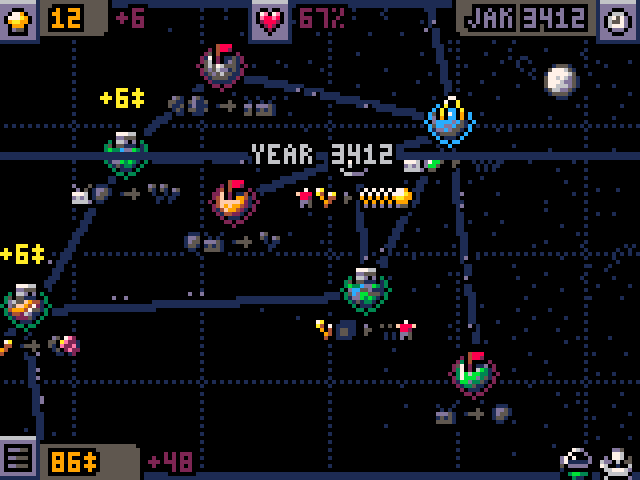

# slipways-love

*Slipways* (PICO-8 edition) ported to C, running on PC through raylib and on the PlayStation.

  

## Running the game

```sh
make raylib
tmp/game            # keyboard or gamepad
```

Run it from the repository root. Each session is recorded in `tmp/`; pass a recording to resume it; replaying a recording replaces `save/slipways.sav` with the recording's startup save. Space bookmarks a frame.

The game saves after every action, and the title's `resume` row brings that game back; a finished game is erased.

Left alone on the title for 20 seconds, the game plays a short captioned demo of itself, then comes back to the title. Any button stops it at once; that press does nothing on the title, and the demo never touches your save.

## PlayStation build

The PSX build (`docs/psx-game.md`) packs the game into a CD image, `slipways.bin`/`.cue`, checked in the pcsx-redux emulator, where every frame's budget is 263 hblanks. The Miyoo Mini Flip (PCSX-ReARMed) was never measured.

## Controls

The game reads 12 numbered buttons. `keymap.default.cfg` says which keyboard keys and gamepad buttons press each one; `bindings.default.cfg` says what each button does in each mode, and explains every mode and action.

To change either, copy it to `keymap.cfg` or `bindings.cfg` (both gitignored), edit the copy, then run `make raylib`, which prints the file it compiled for each. A personal `bindings.cfg` replaces the default whole: a missing line leaves that action unbound. Recordings made with a personal `bindings.cfg` can't be replayed.

## To do

Rule for this list: each item is one clear sentence of at most 30 words, readable without any outside reference.

- [ ] Add a cheat that grants bonus score points, so a short e2e can show the score panel's lit stars.
